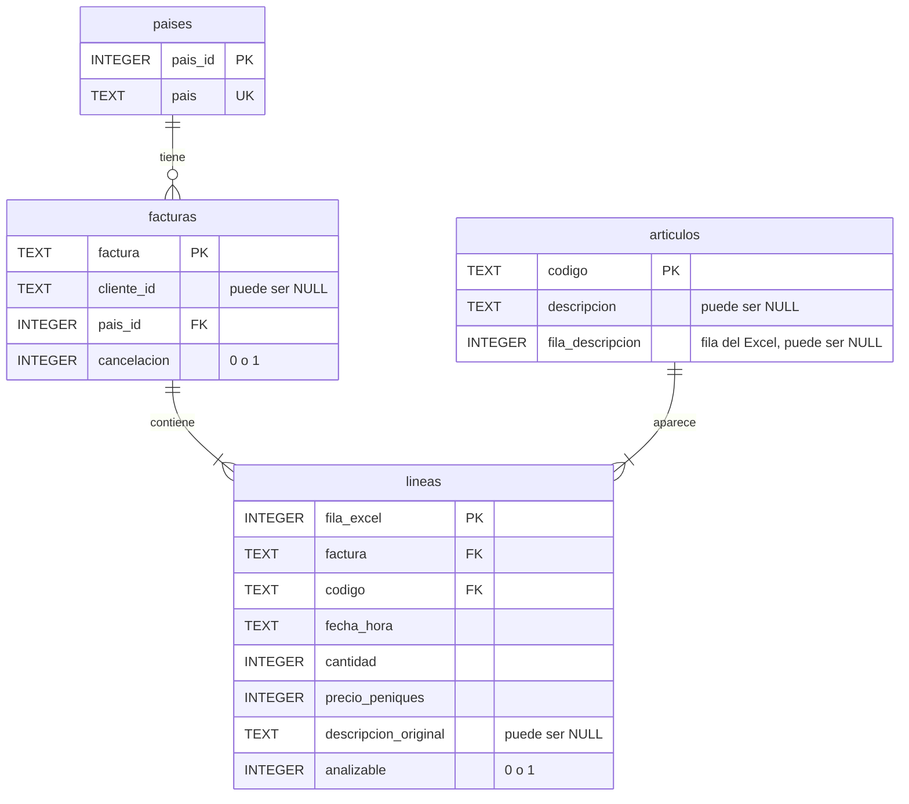

# Modelo relacional

Un renglón del archivo original se convierte en una fila de `lineas`.
La separación no agrega ventas ni cambia la cantidad de registros recibidos.

| Tabla | Una fila representa | Clave y motivo |
| --- | --- | --- |
| paises | Un nombre de país recibido. | `pais_id`: se asigna después de ordenar los nombres; `pais` es único. |
| facturas | Un número de factura recibido, de venta o cancelación. | `factura`: sus renglones coinciden en país y cliente. La hora puede variar entre líneas. |
| articulos | Un código de artículo o concepto recibido. | `codigo`: la descripción puede cambiar. La etiqueta elegida guarda su fila de procedencia. |
| lineas | Un renglón físico del Excel dentro del trimestre. | `fila_excel`: permite volver al original y conservar repeticiones sin inventar un ID comercial. |

`PK` es clave primaria: identifica una fila de la tabla. `FK` es clave foránea:
apunta a una fila de otra tabla. `UK` marca un valor único. Un país tiene muchas
facturas, una factura tiene muchas líneas y un artículo aparece en muchas líneas.
Cada línea pertenece a una sola factura y a un solo código.

Los cuatro dataframes salen del Excel. El código define el período, las reglas
y las claves de países. `procedencia.csv` registra el archivo utilizado.

El cliente es un atributo opcional de la factura. NULL indica que falta su ID.

El catálogo de artículos usa la primera descripción válida con precio positivo,
o la primera válida si no hay otra. La descripción recibida se conserva en `lineas`, y
`fila_descripcion` permite revisar qué fila eligió el código.

Algunas descripciones nombran packs. Las cantidades son unidades comerciales
del código, no el número de piezas individuales que contiene cada pack.

